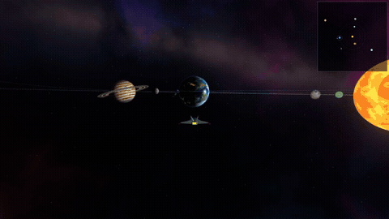
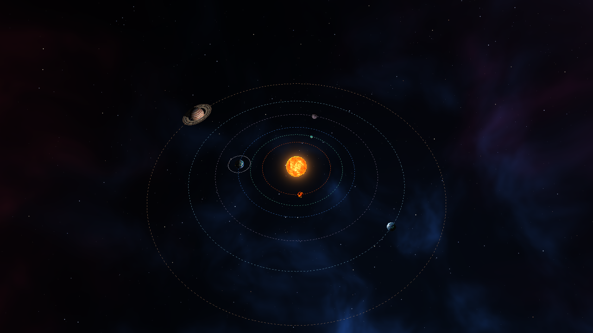
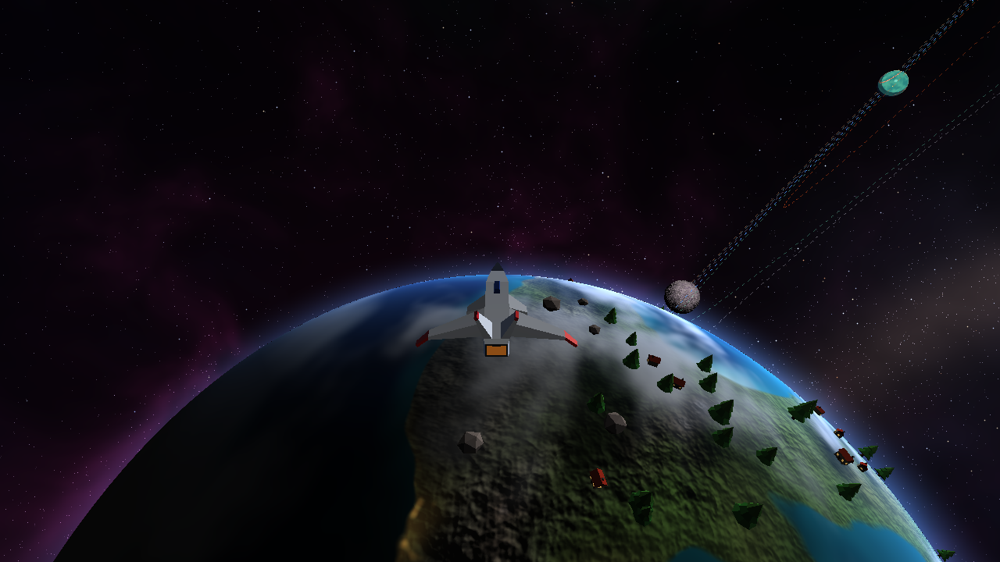

# Proyecto 3: Space Travel

Sistema solar inventado que se explora con una nave, dibujado con un **software renderer propio en Rust**. raylib solo se usa para abrir la ventana, leer el teclado y el mouse y mostrar el framebuffer ya terminado. Todo lo demás (transformaciones, recorte, rasterizado, depth test, shaders, culling y niveles de detalle) está hecho a mano en este repo.

🎬 **Video completo:** [docs/recorrido.mp4](docs/recorrido.mp4): vuelo por el espacio, llegada a Tessara, vuelta junto a la serpiente de roca, paso por la luna Nix, visita a Mirra y a Orvane, salida y vista del sistema.

| Vista del sistema | Superficie de Tessara |
|---|---|
|  |  |

**Integrante:** Angel Sanabria (carné 24725). Trabajo individual.
