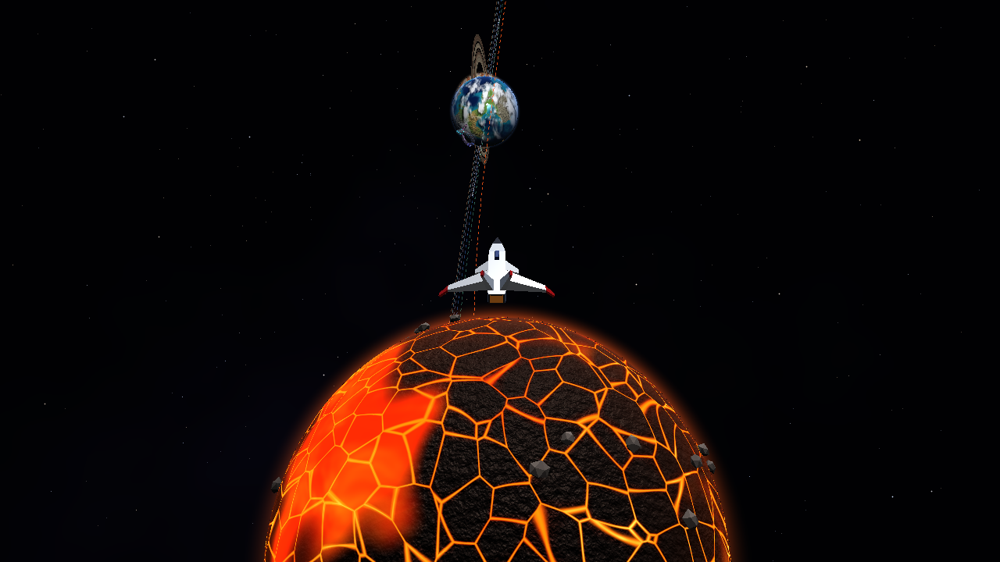
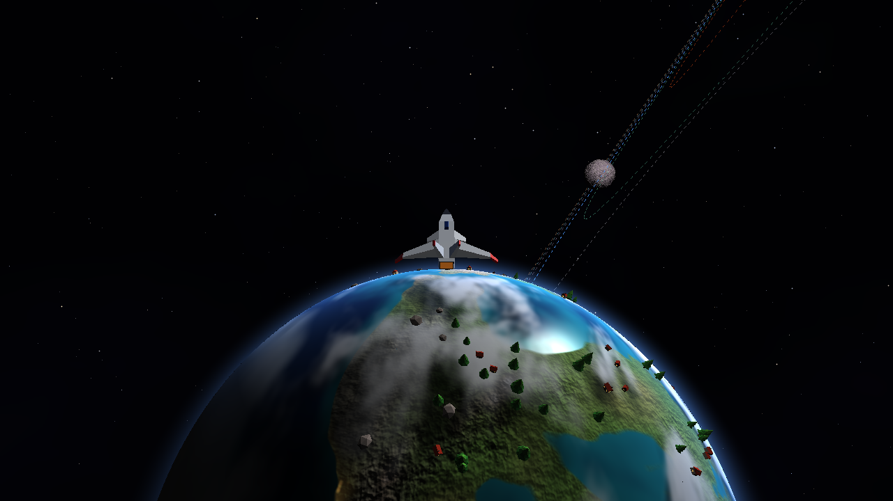
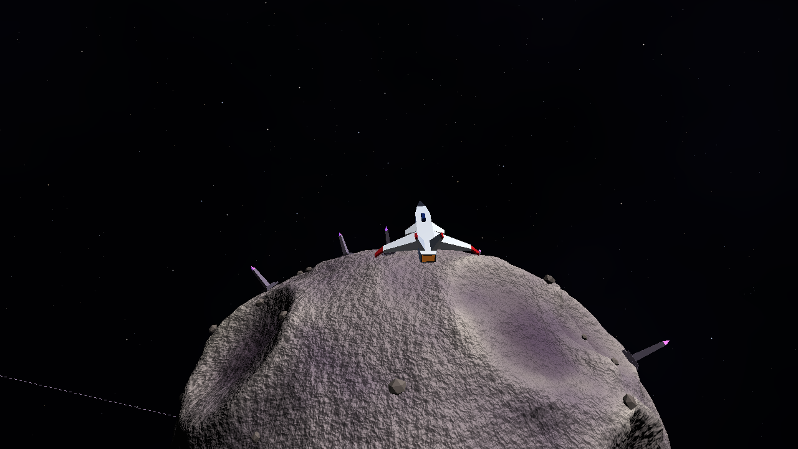
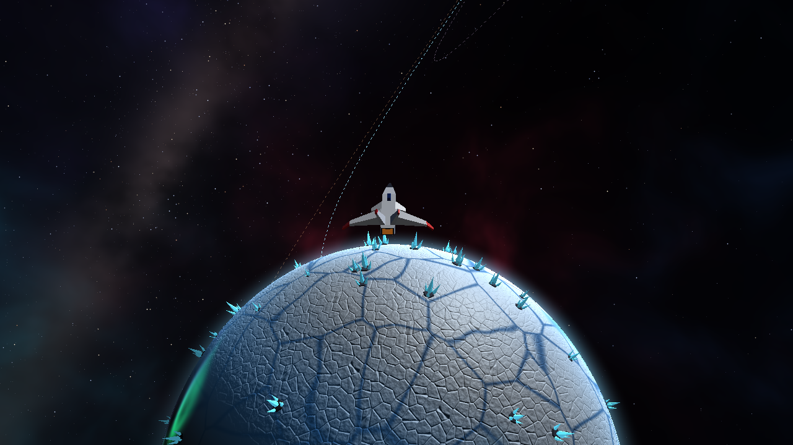
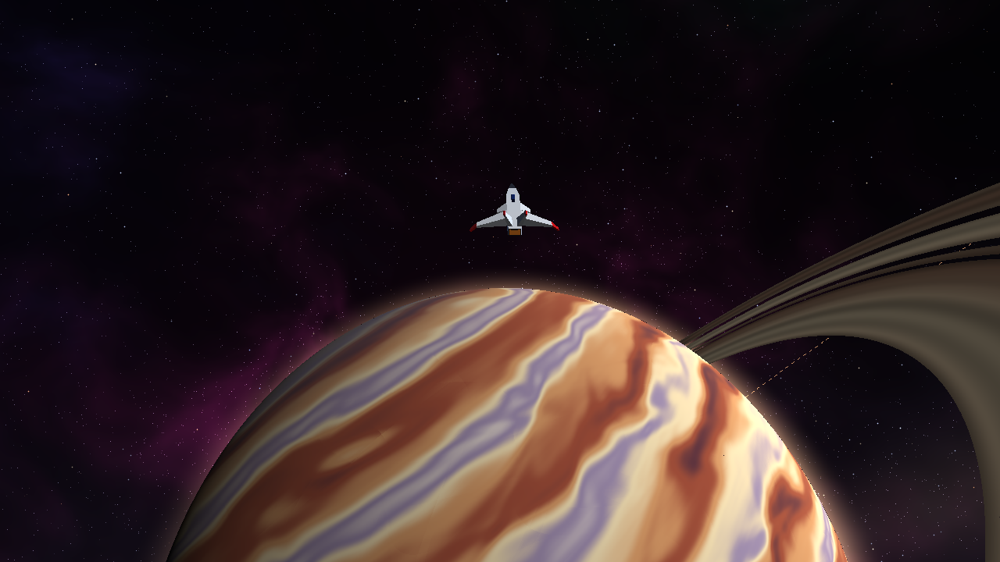
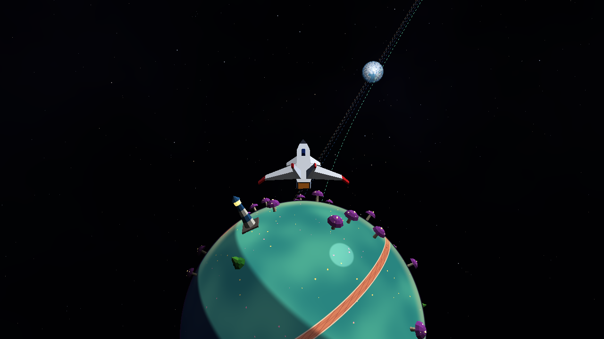
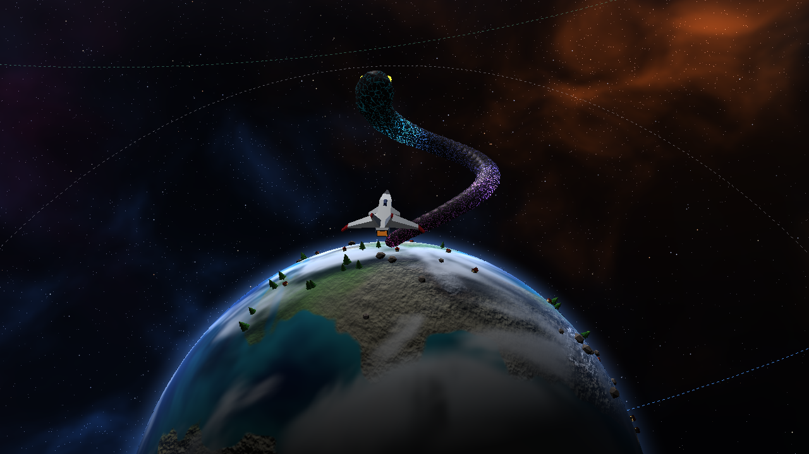
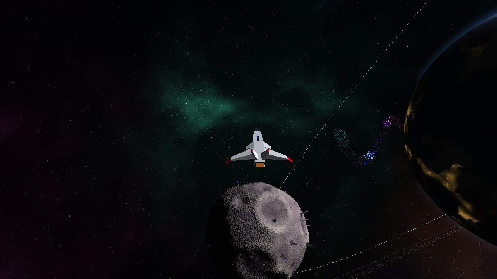

# Proyecto 3: Space Travel

Sistema solar inventado que se explora con una nave, dibujado con un **software renderer propio en Rust**. raylib solo se usa para abrir la ventana, leer el teclado y el mouse y mostrar el framebuffer ya terminado. Todo lo demás (transformaciones, recorte, rasterizado, depth test, shaders, culling y niveles de detalle) está hecho a mano en este repo.


🎬 **Video completo:** [docs/recorrido.mp4](docs/recorrido.mp4): vuelo por el espacio, llegada a Tessara, vuelta junto a la serpiente de roca, paso por la luna Nix, visita a Mirra y a Orvane, salida y vista del sistema.

| Vista del sistema | Superficie de Tessara |
|---|---|
|  |  |

**Integrante:** Angel Sanabria (carné 24725). Trabajo individual.

---

## Cómo correrlo

Requisitos: Rust (edición 2024) y lo que necesita raylib para compilar (CMake y un compilador de C). En Linux además: `libxrandr-dev libxinerama-dev libxcursor-dev libxi-dev libgl1-mesa-dev`.

```bash
cargo run --release
```

> Usar siempre `--release`: en debug el ruido de los shaders es muchísimo más lento.

Otros modos (no abren ventana):

```bash
cargo run --release -- capture              # capturas del README en docs/
cargo run --release -- capture rendimiento  # tabla de docs/rendimiento.md
cargo run --release -- tour                 # cuadros del video en docs/frames/
bash tools/make_video.sh [musica.mp3]       # arma docs/recorrido.mp4 y el GIF (necesita ffmpeg)
```

## Controles

| Tecla | Acción |
|---|---|
| **W / S** | Acelerar / reversa (el empuje sube y baja de forma progresiva) |
| **A / D** | Girar a la izquierda / derecha |
| **Flechas ↑ / ↓** | Subir / bajar la nariz |
| **Q / E** | Bajar / subir |
| **Espacio** | Frenar |
| **Shift** | Turbo |
| **Tab** | Entrar o salir del **modo local** (rodear el planeta más cercano) |
| **1 - 7** | Piloto automático: Ignis, Tessara, Kharon, Glacia, Orvane, Mirra y Nix (la luna) |
| **V** | Vista del sistema desde arriba |
| **Mouse derecho** | Mirar alrededor de la nave · **Rueda**: distancia de la cámara |
| **C / L / N** | Encender o apagar el descarte, los niveles de detalle y el mapeo de normales |
| **G / P** | Gravedad / pausar las órbitas |
| **O / M / H** | Órbitas / minimapa / ayuda |
| **F1** | Resolución completa, media o un tercio (para computadoras lentas) |
| **F2 / K** | Ocultar los textos (para grabar) / guardar captura |

**Parámetros en vivo** (se aplican al planeta más cercano o al del modo local; sirven para la demostración):

| Tecla | Parámetro |
|---|---|
| **9 / 0** | Radio del planeta |
| **, / .** | Intensidad del shader (nubes de Tessara, calor de Ignis, tormenta de Orvane, aurora de Glacia, relieve de Kharon, flores de Mirra, manchas del sol) |
| **- / =** | Velocidad orbital (multiplicador del tiempo de las órbitas) |
| **[ / ]** | Semilla de la distribución de objetos (cambia dónde salen los árboles, casas, etc.) |

En la parte de abajo de la ventana se ven los valores actuales y los contadores de triángulos y objetos.

---

## El sistema

Todos los cuerpos están en el plano eclíptico (y = 0). Las órbitas son circulares, cerca del sol para que el viaje sea corto, y las posiciones dependen del tiempo transcurrido, no de los cuadros. Nix es una luna: da vueltas alrededor de Tessara mientras Tessara da vueltas al sol.

| Cuerpo | Qué tiene |
|---|---|
| **Solmira** (sol) | Plasma animado con ruido 4D, granulación, manchas solares, oscurecimiento del borde y halo |
| **Ignis** | Planeta de lava: placas de corteza (Voronoi) y lava que fluye por las grietas y en los mares bajos. Rocas encima |
| **Tessara** | Planeta rocoso: océanos, biomas, hielo, nubes con sombra, luces de ciudad de noche. Árboles, casas, rocas y **la serpiente de roca** |
| **Kharon** | Planeta sin atmósfera con la **geometría deformada** (montañas y cráteres). Obeliscos y rocas |
| **Glacia** | Hielo agrietado con mapa de normales, mares congelados que brillan y aurora en los polos. Cristales |
| **Orvane** | Gigante gaseoso con bandas que fluyen y una tormenta, más un anillo con huecos y la sombra del planeta |
| **Mirra** | Planeta miniatura estilo caricatura: luz en tres tonos, contorno, camino en espiral. Hongos gigantes, árboles y un faro |
| **Nix** | Luna de Tessara, también deformada pero con otra semilla de terreno (otros cráteres y montañas) |

| Ignis | Tessara | Kharon |
|---|---|---|
|  |  |  |
| **Glacia** | **Orvane** | **Mirra** |
|  |  |  |

| La serpiente de roca de Tessara | Nix, la luna |
|---|---|
|  |  |

---

## Características del menú que se solicitan

| Característica | Puntos | Dónde se ve | Dónde está en el código |
|---|---|---|---|
| Planetas distinguibles que orbitan, rotan y se ven de cerca (6 planetas) | 50 | Teclas 1-6 | `system.rs`, `shaders/*` |
| Tipos de modelo propio en la superficie: árbol, roca, casa, cristal, obelisco, hongo, faro | 20 | Tessara, Ignis, Glacia, Kharon, Mirra | `assets/*.obj`, `decor.rs` |
| Distribución procedural reproducible con semilla | 10 | Teclas [ y ] cambian la semilla; con la misma semilla salen las mismas posiciones | `decor.rs`, `rng.rs` |
| Posición y orientación sobre la superficie curva mientras el planeta rota | 5 | Cualquier planeta con objetos | `decor::model_matrix` |
| Shaders propios distintos (sol, rocoso, gaseoso, lava, hielo, Kharon, caricatura, serpiente, anillo) | 24 | Cada planeta | `src/shaders/` |
| Shader animado | 8 | Lava de Ignis, plasma del sol, aurora de Glacia, pulso de la serpiente | `shaders/lava.rs`, `star.rs`, `ice.rs`, `serpent.rs` |
| Mapeo de normales en el renderizador | 8 | Tessara, Ignis, Glacia, Kharon (tecla N para comparar) | `normal_map.rs` |
| Deformación de la geometría con ruido | 10 | Kharon y Nix | `geometry::deform`, `shaders/barren.rs::height` |
| Etapa propia de generación/subdivisión de geometría | 10 | Todos los planetas (icosfera subdividida) y la serpiente (se arma cada cuadro) | `geometry.rs`, `serpent.rs` |
| Modo de control local para rodear un planeta | 8 | Tab cerca de un planeta | `local_orbit.rs` |
| Aceleración, frenado y giro progresivos, iguales en cualquier equipo | 8 | Vuelo libre | `ship.rs`, paso fijo en `game.rs` |
| Gravedad de los planetas que cambia la trayectoria | 10 | Soltar el acelerador cerca de un planeta (tecla G la apaga) | `game::gravity_at` |
| Colisión que impide atravesar el planeta | 4 | Chocar contra cualquier planeta | `game::collide` |
| Descartar objetos fuera de la vista | 7 | Tecla C y contadores del HUD | `culling.rs`, `render.rs` |
| Distintos niveles de detalle según la distancia | 8 | Tecla L y la fila "LOD" del HUD | `render::lod_for` |
| Coherencia visual y claridad de la experiencia | 10 | Minimapa, órbitas, etiquetas, marcador del destino, atmósferas, estela de los motores, ayuda en pantalla | `overlay.rs`, `main.rs` |

La comparación del descarte y los niveles de detalle está en **[docs/rendimiento.md](docs/rendimiento.md)**.

---

## Cómo funciona

### Pipeline

```
vértices ─► vertex shader ─► recorte con el plano cercano ─► rasterizado (baricéntricas)
        ─► depth test ─► G-buffer ─► fragment shader (en paralelo) ─► fondo, órbitas, brillo, minimapa
```

1. **Vertex shader** (`pipeline.rs`): cada vértice pasa por modelo → vista → proyección. Las mallas son indexadas, así cada vértice se transforma una sola vez.
2. **Recorte** (`pipeline::clip_near`): los triángulos que cruzan el plano cercano se cortan con Sutherland-Hodgman. Sin esto, al volar pegado a un planeta los triángulos que pasan detrás de la cámara se tendrían que botar enteros y se verían hoyos.
3. **Rasterizado**: funciones de arista evaluadas de forma incremental en cada fila, y los atributos se interpolan con perspectiva correcta (usando 1/w).
4. **Depth test**: la profundidad se guarda como 1/w, que tiene buena precisión cerca (la nave) y lejos (los planetas del fondo).
5. **G-buffer** (`framebuffer.rs`): de cada píxel solo se guarda el fragmento más cercano. Después el fragment shader corre **una vez por píxel visible**, repartido en hilos con `rayon`. Así los shaders pesados no se calculan para cosas que luego quedan tapadas.

### Geometría procedural

Los planetas no vienen de un `.obj`. Se arman desde un icosaedro de 20 triángulos y cada nivel parte cada triángulo en 4 (`geometry::subdivide`), empujando los puntos medios a la esfera. Se generan los niveles 0 a 5 (de 20 a 20 480 triángulos) y el render escoge cuál usar según el tamaño en pantalla. Kharon usa las mismas esferas pero con los vértices movidos por `barren::height` (fBm, ruido "ridged" y 16 cráteres), y se le recalculan las normales.

### Objetos sobre la superficie

`decor::scatter` genera puntos al azar sobre la esfera con un PCG32 con semilla, y cada punto se acepta según **el mismo ruido que usa el shader**: los árboles caen en tierra húmeda, las casas donde de noche hay luces de ciudad, y no queda nada flotando sobre el mar, la lava o el camino de Mirra. Cada objeto guarda su dirección en el espacio del planeta, así que cada cuadro se pasa al mundo con el giro actual y se para con su eje Y en la normal.

### Mapeo de normales

Al arrancar se generan dos texturas de normales (roca y hielo agrietado) a partir de un campo de altura que se repite sin costuras (ruido 4D sobre un toro y Voronoi en una rejilla que da la vuelta). En el shader se leen con proyección triplanar y cada lectura se pasa al espacio del objeto con su base tangente (T, B, N).

### Navegación

- **Vuelo libre** (`ship.rs`): la entrada cambia el empuje y la velocidad de giro, que llegan a su valor con suavizado exponencial. La física corre a paso fijo de 1/120 s (`game.rs`), así responde igual en una computadora lenta que en una rápida.
- **Gravedad**: suma de GM/d² de todos los cuerpos; GM sale de la gravedad en la superficie de cada uno.
- **Colisión**: si la nave entra en un cuerpo (usando la altura real del terreno en Kharon) se empuja a la superficie y se le quita la velocidad que la metía.
- **Modo local** (`local_orbit.rs`): la nave se engancha al planeta como dirección + rumbo + altura. W/S avanzan sobre un círculo máximo, A/D cambian el rumbo y Q/E la altura. Al entrar y salir se conservan posición y velocidad, así el vuelo no se corta y no hay pantalla de carga.
- **Piloto automático** (`autopilot.rs`): usa los mismos controles que el jugador, así que la nave vuela de verdad hasta el planeta y al llegar entra sola al modo local.

### Descarte y niveles de detalle

- Los 6 planos de la vista salen de la matriz vista-proyección (`culling.rs`). Cada planeta, objeto de la superficie y segmento de la serpiente tiene una esfera envolvente; si queda afuera no se transforma ni un vértice.
- Además, los triángulos con los tres vértices afuera del mismo plano y los que están de espaldas se descartan antes de rasterizar.
- El nivel de la icosfera depende del radio en píxeles del planeta, y los objetos de la superficie solo se dibujan cuando el planeta se ve grande.

### Estructura

| Archivo | Contenido |
|---|---|
| `main.rs` | Ventana, teclado, HUD y etiquetas |
| `game.rs` | Estado: tiempo, órbitas, física, gravedad, colisiones, modos y parámetros en vivo |
| `render.rs` | Arma el cuadro: culling, LOD, llamadas al pipeline y fragment shaders |
| `pipeline.rs` | Vertex shader, recorte, rasterizado y depth test |
| `framebuffer.rs` | Color, profundidad y G-buffer |
| `geometry.rs` | Icosfera, subdivisión, deformación y anillo |
| `culling.rs` | Planos de la vista y prueba de esferas |
| `system.rs` | Datos de los cuerpos y sus órbitas |
| `decor.rs` | Distribución y orientación de los objetos de la superficie |
| `serpent.rs` | La serpiente de roca (geometría que se arma cada cuadro) |
| `ship.rs`, `local_orbit.rs`, `autopilot.rs`, `camera.rs` | Nave, modo local, piloto automático y cámara |
| `normal_map.rs` | Texturas de normales y lectura triplanar |
| `background.rs`, `overlay.rs` | Nebulosa, estrellas, órbitas, estela, atmósferas, brillo del sol y minimapa |
| `shaders/` | Un fragment shader por material y las funciones de ruido |
| `capture.rs`, `tour.rs` | Capturas, tabla de rendimiento y recorrido del video |
| `assets/` | Nave (del lab 5) y modelos de la superficie con sus materiales |

La nave es la de los labs 4 y 5, y los shaders del sol, Tessara y Orvane salen del lab 6 (adaptados: Tessara ahora usa el mapa de normales en vez de derivar el ruido en cada píxel).
